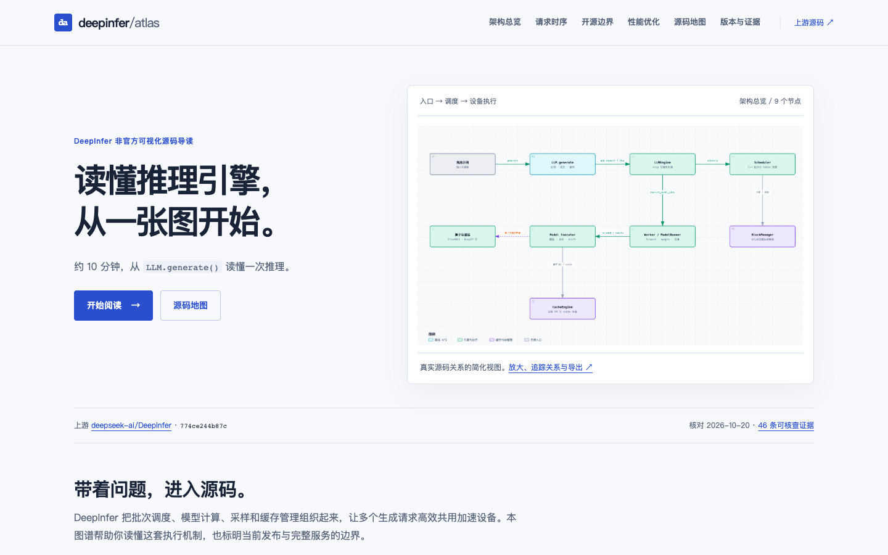

# deepinfer-atlas

**An unofficial visual guide to DeepInfer.**

[简体中文](README.md) · [Reading site](https://ljh-snow.github.io/deepinfer-atlas/index.html) · [Source reading map](https://ljh-snow.github.io/deepinfer-atlas/source-map.html) · [Evidence](docs/evidence.md)

Build a source-level mental model of DeepInfer in about ten minutes. Follow the path from `LLM.generate()` through batching, model execution, sampling, and device cache management. Then explore CPU/device overlap, DSpark verification scheduling, and the boundary between the released engine and a complete production service.



This is an independent community project with no affiliation with or endorsement by DeepSeek. **[Read online](https://ljh-snow.github.io/deepinfer-atlas/) · [GitHub repository](https://github.com/LJH-snow/deepinfer-atlas)**. The reading site is live on GitHub Pages. You can also download the repository and open `site/index.html`, or start the local server below. The site is written in Chinese, retaining original technical identifiers. This English README explains its purpose, scope, and use independently.

## What you can learn

| Question | Entry point |
| --- | --- |
| What does DeepInfer coordinate, and how do its modules work together? | [Architecture](https://ljh-snow.github.io/deepinfer-atlas/architecture.html) / [Interactive diagram](https://ljh-snow.github.io/deepinfer-atlas/diagrams/architecture.html) |
| How does an offline request move through the generation loop? | [Request lifecycle](https://ljh-snow.github.io/deepinfer-atlas/request.html) / [Interactive diagram](https://ljh-snow.github.io/deepinfer-atlas/diagrams/request.html) |
| What is released, supported for integration, or absent from this release? | [Release boundary](https://ljh-snow.github.io/deepinfer-atlas/scope.html) / [Interactive diagram](https://ljh-snow.github.io/deepinfer-atlas/diagrams/scope.html) |
| Where do asynchronous scheduling and DSpark save work? | [Performance mechanisms](https://ljh-snow.github.io/deepinfer-atlas/performance.html) |
| Which source files should I read next? | [Three reading routes](https://ljh-snow.github.io/deepinfer-atlas/source-map.html) |
| What supports the diagrams and claims? | [Evidence page](https://ljh-snow.github.io/deepinfer-atlas/evidence.html) / [Machine-readable evidence](data/evidence.json) |

A suggested first pass takes approximately 2 minutes on architecture, 3 on the request lifecycle, 2 on release scope, and 3 on performance mechanisms. The source map supports a deeper reading session afterward.

## A pinned, auditable baseline

- Upstream: [deepseek-ai/DeepInfer](https://github.com/deepseek-ai/DeepInfer).
- Analyzed commit: [`774ce244b87cc0eb8d4b94ab9f5de2ab22049f01`](https://github.com/deepseek-ai/DeepInfer/tree/774ce244b87cc0eb8d4b94ab9f5de2ab22049f01).
- Checked on **October 20, 2026**, using the Asia/Shanghai date.
- 46 evidence records across 24 files, each with symbols, line ranges, immutable links, and excerpt checksums. All **23 diagram nodes and 19 relationships** have an explicit [evidence mapping](data/diagram-map.json).
- Claims distinguish source confirmation, official documentation, and explanatory simplification. The logical request diagram is not a wall-clock trace of default ZOS execution.

A crucial distinction: **the repository implements device KV/state caches and block management. This does not mean it includes the complete production cache storage system, long-lived reuse service, or request load balancing across DP replicas.** The scope page separates released code, integration hooks, and components explicitly excluded by the upstream release.

We performed static source verification and website/diagram checks. **We did not run a DeepInfer model, reproduce hardware benchmarks, or deploy a production inference service.** See the [verification record](docs/verification.md) for the tested surface and its limits.

## Read and build locally

Open `site/index.html` directly, or use Python 3.10+ and its standard library:

```sh
python3 scripts/build.py
python3 -m http.server 4173 --bind 127.0.0.1 --directory site
```

Visit <http://127.0.0.1:4173/>. The build generates eight Chinese reading pages and stages deployment files in `dist/`. Reading and building require no GPU/NPU, frontend framework, Node.js packages, or backend service. Relative asset links support hosting under a project subpath.

Check static links, source pins, diagram mappings, and artifact receipts:

```sh
python3 scripts/verify.py
```

For full source excerpt verification:

```sh
python3 scripts/fetch_upstream.py
python3 scripts/verify.py --require-upstream
```

The ignored research checkout lives in `.upstream/DeepInfer/`. The fetch script uses the recorded SHA and refuses to reset an existing checkout to another revision.

## Reproducible diagrams

The three standalone interactive diagrams are generated from `diagrams/specs/*.json` using **Archify 2.16**. The generated HTML includes theme switching, zoom, search, node inspection, relationship tracing, and static image/vector exports. Motion is disabled; WebM is outside this delivery. See the verification record for the interactions and exports actually tested.

Content lives in `content/`, shared page markup in `templates/`, styling in `site/assets/style.css`, and evidence in `data/`. The prebuilt HTML and preview images are committed, so readers do not need Archify.

To regenerate diagrams, install the matching Archify package separately and run:

```sh
ARCHIFY_HOME=/path/to/archify python3 scripts/diagrams.py
```

The script runs `validate → deliver → visual-check` in order and stops on failure. **Automated acceptance does not replace inspecting screenshots or re-exporting PNG previews from the final HTML.** See [maintenance instructions](docs/maintenance.md), [diagram receipts](docs/diagrams.md), and [third-party notices](THIRD_PARTY_NOTICES.md).

## Deployment status

`site/` and `dist/` are ready for a static host. GitHub Pages is enabled for this repository. The included [deployment workflow](.github/workflows/pages.yml), based on GitHub's official static-site template, publishes `site/` on pushes to `main` and can also be run manually.

**Published on October 21, 2026**, with the owner’s authorization: [LJH-snow/deepinfer-atlas](https://github.com/LJH-snow/deepinfer-atlas) and [https://ljh-snow.github.io/deepinfer-atlas/](https://ljh-snow.github.io/deepinfer-atlas/). The Pages deployment and production resources were checked. No existing repository was overwritten. Publishing this guide does not change the pinned upstream analysis baseline.

A repository description, bilingual taglines, launch copy, preview image, and three follow-up article topics are prepared in [release materials](docs/release.md).

## Attribution and license

DeepInfer is licensed under [Apache-2.0](https://github.com/deepseek-ai/DeepInfer/blob/774ce244b87cc0eb8d4b94ab9f5de2ab22049f01/LICENSE). Original material in this guide uses the [MIT License](LICENSE); it does not relicense upstream code. The generated Archify runtime retains its MIT attribution to tt-a1i and Cocoon AI. See [THIRD_PARTY_NOTICES.md](THIRD_PARTY_NOTICES.md). DeepSeek, DeepInfer, and related names belong to their respective owners.
